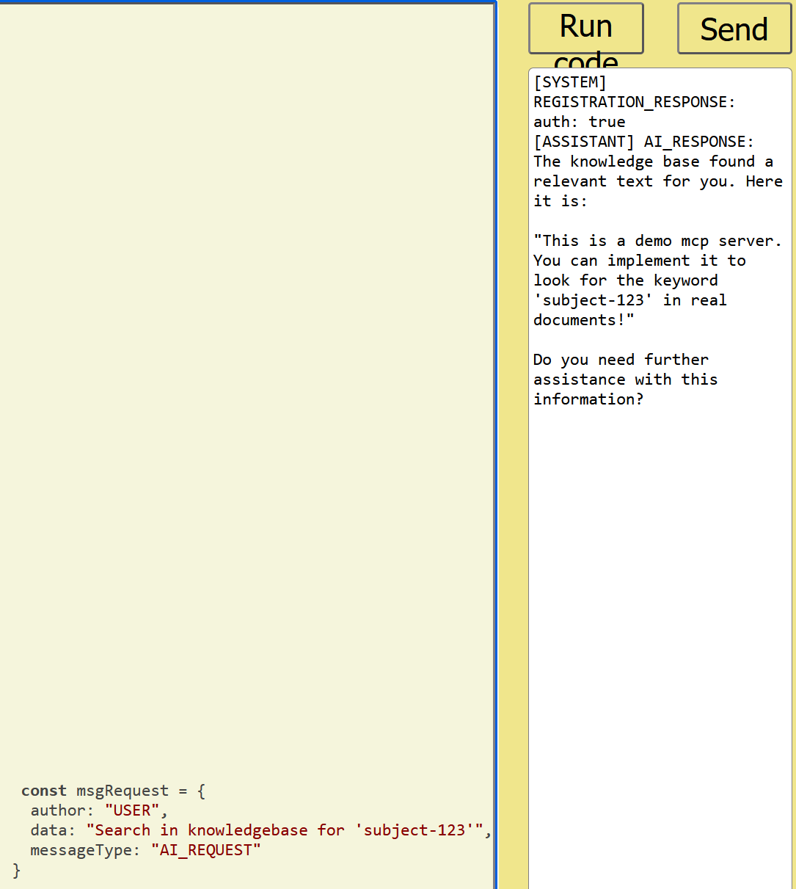
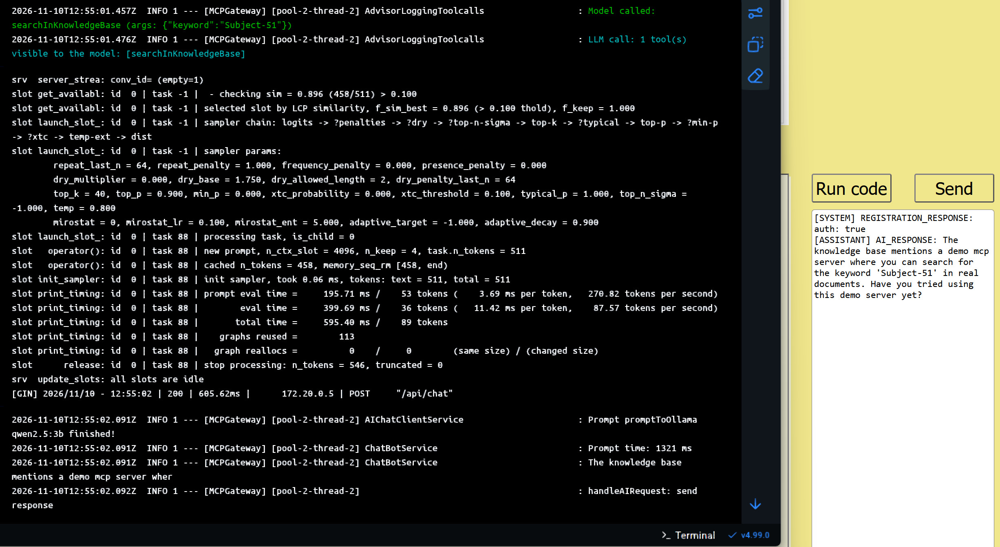
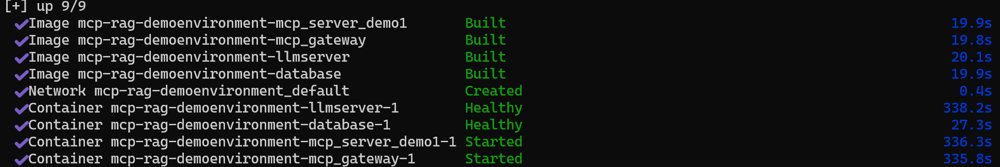

# McpGatewayWebsocket
This Project shows how to use Java Spring AI and Websocket
to set up an scalable AI-Service using MCP easy to test?

<h4>The gateways info page brings a little code demo for live testing</h4>
</img>
<h4>Fast prompt (after first warmup inquiry) 1.3 seconds. (NVIDIA GeForce GTX 1660 SUPER 6GB)</h4>
</img>

## Configuration / How to use
<h4>The first start takes some minutes, depending on your internet downstream</h4>

For Starting: <code>docker compose up -d</code>

</img>

### globalenvironment.env
- Contains all notes and parameters
- Is preconfigured for usage with docker compose (local build is commented out)
<table>
<thead>
       <tr>
              <td>Value</td>
              <td>Example</td>
              <td>Description</td>
       </tr>
</thead>
<tbody>
       <tr>
              <td>OLLAMA_URL</td>
              <td>http://llmserver:11434</td>
              <td>URL for LLM-Server</td>
       </tr>
       <tr>
              <td>OLLAMA_MODEL</td>
              <td style="color: green">qwen2.5:3b</td>
              <td>The model that llmserver pulls on start</td>
       </tr>
       <tr>
              <td>MCP_GATEWAS_WS_SESSION_LIFETIME_SECONDS</td>
              <td>3600</td>
              <td>After that time in seconds the session needs a reauthentication.</td>
       </tr>
       <tr>
              <td>MCP_GATEWAY_ACCESS_TOKENS</td>
              <td>uuid-as-an-access-token-used-in-registration-message</td>
              <td>You can use mutiple using token1, token2, token3,... 
Change it in the .env
</td>
       </tr>
       <tr>
              <td>MCP_GATEWAY_INITAL_MCP_SERVERS</td>
              <td>demo-knowledge-base@http://mcp-server-demo1:34590/mcp/sse</td>
              <td>You can use mutiple name@URL, name2@URL2, ...</td>
       </tr>
       <tr>
              <td>MCP_GATEWAY_LOGGING</td>
              <td>INFO</td>
              <td>values: INFO, FINE, FINER, WARNING</td>
       </tr>
</tbody>
</table>
